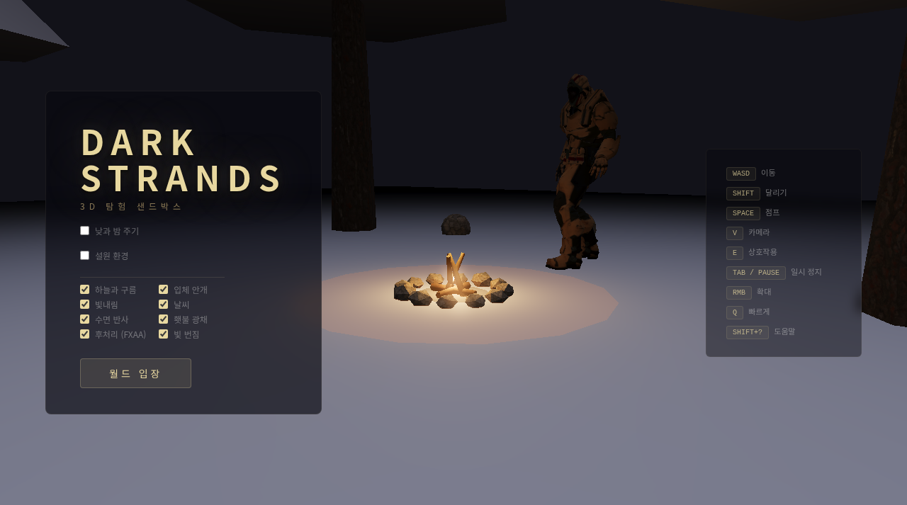

# 🌲 DARK STRANDS | 한글판 3D 탐험

[▶ 한국어판 실행](https://sigco3111.github.io/dark-strands/?v=6) · [원본 README](README.en.md)

점수·승리 조건·엔딩 없이 둘러보는 3D 기술 데모입니다. 원작의 출처와 내부 식별자는 유지하고 사용자 화면을 한국어로 옮긴 포크입니다.

> **사용 전 확인:** 월드 생성과 실시간 효과가 무거울 수 있습니다. 저사양에서는 수면 반사·입체 안개·빛내림·빛 번짐부터 줄여보세요. Esc는 커서 해제이며 Tab/Pause 일시 정지와 다릅니다.

## 실행 화면



> 한국어 Pages 배포의 메뉴와 캠프파이어 장면을 직접 캡처했습니다. 이번 캡처 환경에서는 월드 생성 단계에서 진행되지 않아 월드 화면 대신 메뉴를 사용했습니다.

## 주요 특징

- 절차 생성 마을과 숲
- 파도·수면 반사·안개·빛내림
- 날씨·낮과 밤·설원
- 문·병사 대화·꽃·돌·횃불 상호작용

## 빠른 시작

1. 환경 효과 선택
2. 월드 입장
3. 생성 완료 대기
4. WASD로 이동
5. E로 상호작용

## 기술 스택

Babylon.js 9 · WebGPU / WebGL2 · Havok · ez-tree · JavaScript · esbuild

## 문서 안내

- 아래에서 상세 조작, 한글화 범위, 개발·재배포 방법과 권리 고지를 확인하세요.
- `README.en.md`는 보존된 원본 설명입니다. 원작 기능과 이 포크의 검증 범위는 다를 수 있습니다.
- `korean-localization.patch`는 번역 변경 기록입니다.

---

**VictorZakharov**의 Babylon.js 9 기반 3D 탐험·렌더링 데모를 한국어로 번역했습니다. 점수나 승리 조건 없이 마을, 숲, 물, 날씨와 물리 상호작용을 살펴보는 샌드박스입니다.

## 시작과 조작

메뉴에서 `월드 입장`을 선택하세요. 낮과 밤 주기, 설원, 안개, 빛내림, 날씨, 수면 반사, 횃불 광채, 후처리와 빛 번짐을 켜고 끌 수 있습니다. 무거운 효과를 끄면 성능에 도움이 됩니다.

| 기능 | 조작 |
|---|---|
| 이동 / 달리기 | WASD / Shift |
| 점프·이단 점프 | Space |
| 1인칭 / 3인칭 | V |
| 문·대화·꽃·돌·횃불·침대 | E |
| 돌 던지기 / 배치 | 왼쪽 클릭 |
| 확대 | 오른쪽 버튼 누르기 |
| 빠르게 진행 | Q 누르기 |
| 일시 정지 | Tab / Pause |
| 커서 해제 | Esc |
| 도움말 | Shift + ? |
| 도구창 선택 | 1~5 |
| 도구창 재배치 | Alt를 누르고 드래그 |

터치 기기는 왼쪽 조이스틱으로 이동하고 오른쪽을 쓸어 시점을 바꿉니다. 도움말의 터치 탭에서 세부 조작을 확인하세요.

## 탐험

- 문을 열고 건물과 지붕을 둘러보세요. 돌을 던지면 창문이 깨집니다.
- E로 꽃·돌·횃불을 줍고 도구창에서 선택하여 배치할 수 있습니다.
- 병사와 대화하면 분위기 있는 대사가 나타납니다. 95개 대사를 한국어로 번역했습니다.
- 낮과 밤 주기를 켜면 침대에서 아침까지 잘 수 있습니다.
- 설원에서는 물이 걸을 수 있는 얼음으로 바뀝니다.

## 한국어판 구성

메뉴, 옵션, 로딩·일시 정지 안내, HUD, 상호작용 힌트, 도움말의 모든 조작·월드 설명, 수면 안내와 병사 대사를 번역했습니다. 내부 ID와 모델 파일, 원작 크레딧은 유지했습니다. 한국어 글꼴은 Noto Sans KR 및 시스템 폴백을 사용합니다.

Pages는 루트의 한국어 사전 빌드 HTML을 사용하며 원본 `assets` 경로의 모델·소리·텍스처를 읽습니다. 게임 코드와 Havok 물리 엔진·WASM은 배포 HTML에 포함되어 별도 서버가 필요하지 않습니다. `README.en.md`는 원본 설명이며 `korean-localization.patch`는 소스 변경 기록입니다.

## 개발

```bash
npm ci
npm run build
npm run dev
```

Pages 단일 HTML 재빌드: `node build-pages.cjs` 실행 후 생성된 `ko.html`을 루트 배포 HTML로 사용하세요. 현재 launcher는 `6-ko.html`을 엽니다.

원본 빌드 스크립트와 개발용 import map을 보존합니다. 한국어 소스가 반영된 후 빌드할 수 있습니다. 배포 루트의 launcher HTML과 개발용 HTML은 다르므로 `index.source.html`을 `index.html`로 복사한 뒤 개발·재빌드하세요.

## 원작·권리·성능

원작: **VictorZakharov**와 원본 기여자들

원본: https://github.com/VictorZakharov/dark-strands

원본 데모: https://darkst.netlify.app/

한글화·Pages 배포: **sigco3111** 포크

코드의 MIT `LICENSE`와 `THIRD-PARTY-NOTICES.md`를 그대로 보존했습니다. 모델·음원·텍스처·물리 엔진 등 자산별 조건과 제작자 표시는 해당 문서를 따릅니다. 모든 자산이 코드와 같은 라이선스라는 의미가 아닙니다.

복잡한 월드 생성과 실시간 효과가 있어 처음 입장하는 데 시간이 걸리고 저사양·모바일 환경에서는 느릴 수 있습니다. 원본 월드 진입을 확인했으나 기기마다 성능 차이가 큽니다.
